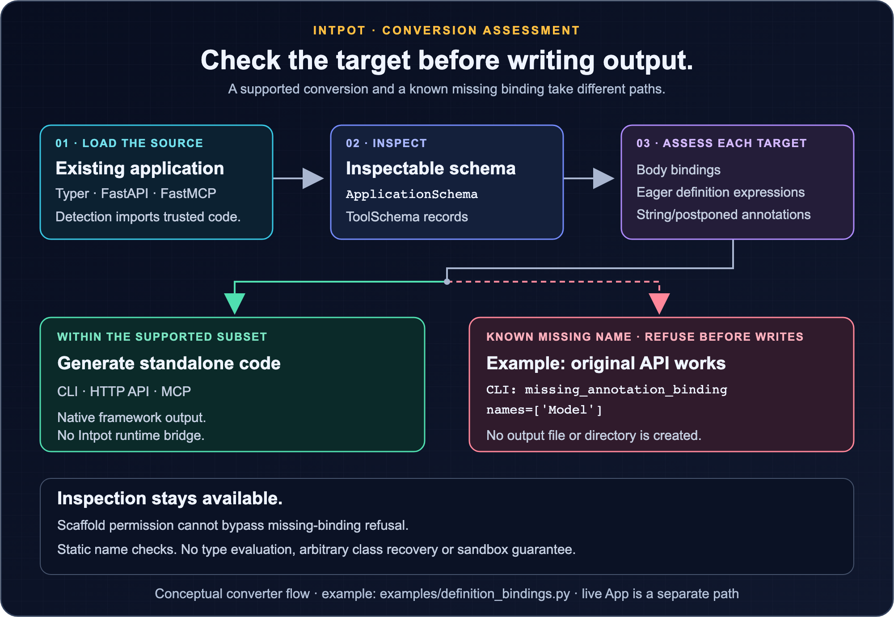

# intpot

<p align="center">
  
</p>

<p align="center">Part of <a href="https://modepot.io/">ModePot</a>. &nbsp; <a href="https://intpot.modepot.io/">Project website</a> &nbsp; <a href="https://tugrul.modepot.io/">Created by Tugrul Guner</a></p>

<p align="center">
  <strong>One typed definition. Three interfaces.</strong>
</p>

<p align="center">
  Define typed tools once for CLI, HTTP, or MCP. Convert apps between Typer, FastAPI, and FastMCP.
</p>

<p align="center">
  <a href="https://pypi.org/project/intpot/"></a>
  <a href="https://pypi.org/project/intpot/"></a>
  <a href="https://github.com/tugrulguner/intpot/actions/workflows/ci.yml"></a>
  <a href="https://discord.gg/u3AANZr6RG"></a>
  <a href="https://github.com/tugrulguner/intpot/stargazers"></a>
  <a href="https://github.com/tugrulguner/intpot/blob/main/LICENSE"></a>
</p>

<p align="center">
  <a href="https://intpot.modepot.io/quickstart/">Quick start</a> ·
  <a href="https://intpot.modepot.io/playground/">Playground</a> ·
  <a href="https://intpot.modepot.io/schema-reference/">Deep docs</a> ·
  <a href="#quick-start">README quick start</a> ·
  <a href="#convert-an-existing-app">Convert an app</a> ·
  <a href="#what-conversion-preserves">Conversion scope</a> ·
  <a href="#architecture">Architecture</a> ·
  <a href="#community">Community</a> ·
  <a href="#contributing">Contributing</a>
</p>

<p align="center">
  
</p>

## Why intpot?

A useful Python function often needs three interfaces: a command for people, an HTTP
endpoint for applications, and an MCP tool for AI agents. Maintaining three copies means
three signatures, three sets of descriptions, and three places for behavior to drift.

intpot gives you two ways out:

| Starting point | What intpot does |
|---|---|
| Plain Python functions | Register them once with `@app.tool()`, then serve or eject CLI, API, and MCP interfaces |
| An existing Typer, FastAPI, or FastMCP app | Inspect it, normalize its tools, and generate either of the other two frameworks |

The output is ordinary Python. Ejected and converted apps do not depend on intpot.

## Quick start

Install every runtime for the complete experience:

```bash
pip install "intpot[all]"
```

### Write once, serve everywhere

Save this as `app.py`:

```python
from intpot import App

app = App("my-app")

@app.tool()
def add(a: int, b: int) -> int:
    """Add two numbers together."""
    return a + b

@app.tool()
def greet(name: str, greeting: str = "Hello") -> str:
    """Greet someone by name."""
    return f"{greeting}, {name}!"
```

Then serve in any mode:

```bash
intpot serve app.py --cli          # Run as Typer CLI
intpot serve app.py --api          # Run as FastAPI on port 8000
intpot serve app.py --mcp          # Run as MCP server for AI agents
```

In CLI mode, everything after the flags belongs to your app:

```bash
$ intpot serve app.py --cli add 2 3
5
$ intpot serve app.py --cli greet World --greeting Hi
Hi, World!
```

With API mode running, call the same names as POST routes with JSON request bodies:

```bash
$ curl -s -X POST http://127.0.0.1:8000/add \
    -H "Content-Type: application/json" \
    -d '{"a": 2, "b": 3}'
5
```

MCP mode exposes `add` and `greet` as FastMCP tools with schemas derived from their type
annotations and defaults.

Or eject to standalone framework code:

```bash
intpot eject app.py --to api       # Export as standalone FastAPI app
intpot eject app.py --to cli       # Export as standalone Typer CLI
intpot eject app.py --to mcp       # Export as standalone FastMCP server
```

### Scaffold a new project

```bash
intpot init my-server --type mcp
intpot init my-app --type cli
intpot init my-api --type api
```

Install only the frameworks you need if you do not want the full extra:

```bash
pip install intpot          # Core commands and Typer output
pip install "intpot[mcp]"   # Add FastMCP support
pip install "intpot[api]"   # Add FastAPI support
```

## Convert an existing app

intpot detects Typer, FastAPI, and FastMCP apps from a Python file and supports every
conversion between them:

```bash
# MCP server -> Typer CLI
intpot to cli server.py

# CLI app -> FastMCP server
intpot to mcp app.py

# CLI app -> FastAPI app
intpot to api app.py

# Write output to a file
intpot to cli server.py --output cli_app.py

# Convert all apps in a directory
intpot to cli ./myproject/
intpot to mcp ./myproject/ --output ./converted/
```

Directory output mirrors the source tree, so `myproject/alpha/tools.py` becomes
`converted/alpha/tools_mcp.py`. Sources sharing a filename in different packages stay
separate files.

Use `intpot inspect app.py` first when you want to see the normalized tool definitions
before generating code. Converted output is readable Python that you can review, test,
and change.

## Conversion assessment before output

<p align="center">
  <a href="docs/assets/intpot-assessment.png"></a>
</p>

This supplementary diagram describes the public converter, not the live `App` path or a
literal execution trace. Conversion uses `ApplicationSchema` with `ToolSchema` records.
Target-specific assessment checks body bindings, eager definition expressions, and supported
string/postponed annotations. Inspection stays available when a known missing binding
prevents conversion; scaffold permission cannot bypass that refusal. These bounded checks
do not evaluate types, recover arbitrary classes or certify Python equivalence. Detection
imports trusted source code and is not a sandbox.

The [runnable example](examples/definition_bindings.py) requests a working original HTTP
API, then reports a missing `Model` in the generated CLI annotations and refuses before
creating output. [Open the full-size assessment diagram](docs/assets/intpot-assessment.png).

## Give your coding agent intpot context

Install project-local instructions for Claude Code, Cursor, Windsurf, GitHub Copilot,
Cline, or OpenAI Codex:

```bash
# Auto-detect agents in your project
intpot add skills

# Target a specific agent
intpot add skills --agent claude
intpot add skills --agent cursor
intpot add skills --agent windsurf
intpot add skills --agent copilot
intpot add skills --agent cline
intpot add skills --agent codex

# Specify a project directory
intpot add skills --path ./myproject/
```

## What intpot handles

- **One definition, three live interfaces:** serve an `intpot.App` through Typer,
  FastAPI, or FastMCP.
- **Six conversion directions:** move existing apps between all three frameworks.
- **Standalone output:** eject or convert to normal framework code with no intpot runtime
  dependency.
- **Behavior-aware transforms:** preserve recoverable function bodies and the direct
  imports they use, and translate framework conventions such as `typer.echo()` into
  return values.
- **Interface fidelity:** carry types, defaults, and async functions through supported
  conversions, and apply FastAPI parameter sources when generating an API.
- **Inspectable semantic core:** use `intpot.load().schema` for an immutable
  `ApplicationSchema`, inspect target projections before generation, or use detached
  `ToolInfo` compatibility objects through `.tools`.
- **Project tooling:** scan directories, scaffold projects, and install agent guidance
  for six coding agents.

## Python API

### Universal App (write once, serve everywhere)

```python
from intpot import App

app = App("my-app")

@app.tool()
def greet(name: str, greeting: str = "Hello") -> str:
    """Greet someone."""
    return f"{greeting}, {name}!"

# Serve as any framework
app.serve(mode="cli")                         # Run as Typer CLI
app.serve(mode="api", port=8000)              # Run as FastAPI on 127.0.0.1
app.serve(mode="mcp")                         # Run as MCP server

# Eject to standalone code
cli_code = app.eject("cli")                   # Returns Typer code string
api_code = app.eject("api")                   # Returns FastAPI code string

# Inspect the canonical application schema
print(app.schema.to_dict())
for tool in app.schema.tools:
    print(tool.name, tool.parameters)
```

### Conversion API (convert existing framework code)

```python
import intpot

# From a file
app = intpot.load("mcp_server.py")
api_schema = app.project("api")               # Immutable target semantics
cli_code = app.to_cli()
api_code = app.to_api()

# From a live instance
from fastmcp import FastMCP

mcp = FastMCP("my-server")

@mcp.tool()
def greet(name: str) -> str:
    return f"Hello, {name}!"

app = intpot.load(mcp)
print(app.to_cli())

# Write directly to a file
app.write("output/cli_app.py", "cli")
app.write("output/api_app.py", "api")
```

**`App`** (universal runtime):
- `.tool(name=None, description=None)` — decorator to register functions as tools; both arguments override the defaults taken from the function name and docstring. Functions with `*args` or `**kwargs` are rejected because those parameters have no consistent CLI, HTTP API, and MCP representation.
- `.serve(mode, host, port)` — serve as CLI, API, or MCP
- `.eject(target)` — generate standalone framework code
- `.schema` — immutable `ApplicationSchema` snapshot shared with conversion
- `.tools` — detached `ToolInfo` compatibility objects

**`IntpotApp`** (conversion wrapper, returned by `intpot.load()`):
- `.to_cli()`, `.to_mcp()`, `.to_api()` — return generated code as strings
- `.schema` — immutable source `ApplicationSchema`, compiled once
- `.project(target)` — immutable target projection used by generation
- `.write(path, target)` — generate and write to a file in one step
- `.tools` — detached `ToolInfo` compatibility objects; mutating them does not alter the schema
- `.source_type` — detected framework type

## What conversion preserves

intpot is designed to produce code you can own, rather than hide conversion behind a
runtime adapter. `ApplicationSchema` is the application-level semantic boundary;
immutable `ToolSchema` and `ParameterSchema` records carry the parts that the three
frameworks share:

- tool names, descriptions, types, defaults, and async behavior;
- recoverable function bodies and the direct imports they reference;
- framework metadata that has a target equivalent, including supported `Query`, `Header`,
  `Path`, and `Body` parameter sources when generating FastAPI;
- scalar returns translated into a shape the target framework can serve correctly.

Frameworks do not have one-to-one equivalents for every feature. FastAPI dependencies
(`Depends`, `Security`, nested dependencies, and route/router/app-level dependencies) are
preserved by inspection, but API-to-CLI/MCP conversion refuses them with
`UnsupportedFastAPIDependencyError` rather than emitting code with missing values. Full
dependency injection mapping remains tracked in
[#20](https://github.com/tugrulguner/intpot/issues/20). Review generated code when a source
uses nested Typer command groups, repeatable CLI options, `Annotated[..., Body(...)]`,
Pydantic model parameters, routes with multiple HTTP methods, streaming, background tasks,
or framework-specific error handling.

Typer/Click parameter callbacks remain inspectable as `unsupported_callback=True` on
parameter metadata (`to_dict()` includes the marker only when true). CLI-to-API/MCP
projection and generation raise `intpot.UnsupportedCLIParameterCallbackError`, naming
all affected tools/parameters and the target, rather than dropping callback validation or
transformation. Assignment-style and `Annotated` declarations are detected. The CLI
reports refusal on stderr with exit status 1 before writing output; `--dry-run` also
refuses. This is a focused known-loss guard, not a general conversion assessment or
callback transpiler. Source CLI behavior is unchanged.

intpot carries direct import statements referenced by a tool body. It does not yet copy
same-module helpers, constants, classes, models, or closure values that the body
references, and it does not follow dependencies across imported modules. Factory-created
apps are not detected by the current AST pre-check. Loading a source file directly also
does not add its directory to `sys.path`, so a sibling import such as
`from helpers import normalize` may require installing the package or setting
`PYTHONPATH`. External services and configuration are not provisioned for you. If intpot
cannot recover a body, public conversion raises `intpot.MissingFunctionBodyError`
before writing output. `app.assess()` returns JSON-compatible body-recovery diagnostics
(`body_recovery_complete`, `missing_function_body`, and per-tool `diagnostics`); this is
not a general fidelity guarantee. `intpot inspect --json` includes an `assessment` when
bodies are missing. Schema inspection and the original source remain usable.

Explicit `allow_scaffold=True` on `.project()`, `.to_cli()`, `.to_api()`, `.to_mcp()`, or
`.write()` (CLI: `--allow-scaffold`) emits labeled `NotImplementedError` implementations,
not successful dummy results. Mixed directory conversions refuse before any output is
written. This permission does not bypass callback or dependency refusals. Recovered
`pass`, ellipsis, and docstring-only no-ops are not missing bodies. Low-level generators
remain scaffold-capable for compatibility; they do not perform converter assessment,
and live `App` serving/ejection is unchanged. See
[`missing_body.py`](examples/missing_body.py) for an executable example.

> [!IMPORTANT]
> Detection imports the source module, so only inspect or convert code you trust. A source
> that cannot be parsed or imported is reported cleanly; during a directory conversion,
> intpot reports the bad file and continues with the rest. intpot is alpha software:
> compile the generated file, import it with its dependencies, and exercise a real CLI
> command, API request, or MCP tool before shipping it.

## Callback and dependency refusal assessment (v0.13.0)

**Availability:** requires v0.13.0 or newer. `app.assess()` and `intpot
inspect --json` report `unsupported_cli_parameter_callback` per affected
tool/parameter/target, and `unsupported_fastapi_dependency` per affected API
tool/target. Dependency diagnostics include route context (`path`, `operation_id`,
`name`) and normalized dependency names. Both include `source_location: null`, a
`consequence`, `suggested_action`, and `reference_analysis: "skipped_due_to_refusal"`:
body-binding analysis for that target was not run, so the refusal does not imply that no
binding issues exist. The consequence describes what would be lost without equivalent
implementation; conversion is refused, so the source behavior is not silently dropped.
`--allow-scaffold` does not bypass either refusal. Non-API dependency metadata is not
treated as FastAPI injection. Run `.venv/bin/python examples/conversion_refusals.py`
from a checkout to see source behavior, structured reports, and before-write refusal.


## MCP-source numeric validation (unreleased)

`examples/inventory_reservation.py` is an MCP inventory reservation service with
bounded quantities and packs, defaults, a helper's stock-limit error and optional
receipts. Run `uv run --all-extras --with httpx python examples/mcp_application_conformance.py`
to compare its native MCP client with generated CLI and HTTP consumers. Required
quantity becomes a positional CLI argument; the HTTP adapter uses its projected route
and JSON request body. Valid calls write receipts; rejected inputs and stock-limit
failures do not. No mutable stock state or transaction semantics are claimed.

Ordinary primitive int/float inclusive finite Field/Annotated constraints retain the
existing minimum/maximum fields. Supported defaults embedded inside Annotated Field
metadata remain defaults, not required inputs. Constrained or validated None defaults
are explicitly refused. Additional numeric validators, exclusive/multiple-of/
strict constraints, unsupported defaults and factories are not silently discarded:
`unsupported_mcp_numeric_range` remains inspectable, assessment reports that code, and
`intpot.UnsupportedMCPNumericRangeError` refuses generation before writes, even with
scaffold permission. This is not general Pydantic, context, dependency, structured-model
or arbitrary MCP behavior conversion. Inputs are a documented shared numeric domain;
coercion, responses and errors remain framework-native. This capability is unreleased
and is not included in public v0.16.0.

## API-source numeric validation (unreleased)

The storage-cost service in `examples/storage_quote.py` is a second application-led
conformance case, with an HTTP API as its source. Run
`uv run --all-extras --with httpx python examples/api_application_conformance.py`.
It compares original HTTP, generated CLI and native MCP results, omitted defaults,
rejected/missing inputs, a helper's capacity error and receipts written only on success.

Ordinary primitive `int`/`float` FastAPI parameters retain finite inclusive `ge`/`le`
bounds in the existing `minimum`/`maximum` schema fields. Default-style and Annotated
Query/Body/Header/Path metadata use normalized FastAPI fields; ordinary required
parameters and supported defaults retain their existing interface placement.
Generated CLI/MCP adapters enforce their native bounds before the business body.

Exclusive bounds, multiple-of/strict/custom numeric validation, unknown validation
metadata and unsupported constrained defaults are not silently stripped. Inspection
retains `unsupported_api_numeric_range`; assessment reports that code per target, and
`intpot.UnsupportedAPINumericRangeError` refuses projection/generation before writing,
even with scaffold permission. Existing dependency/callback refusal precedence remains.
The marker is preserved through immutable schemas, adapters, hashes and detached JSON;
false is omitted. This is a bounded numeric contract, not general Pydantic model or
validator conversion. String constraints and arbitrary annotation metadata are not
certified; input coercion and error/response formats remain target-native. Public
v0.16.0 does not include this source capability. No package release is implied.

## Bounded numeric-range conversion (unreleased)

**Availability:** source checkout containing this change only; public v0.16.0 does not
provide this numeric-validation guarantee.

A Typer CLI can declare inclusive numeric bounds with `typer.Option(min=..., max=...)`
or `typer.Argument(min=..., max=...)`. The bounded conversion slice preserves ordinary
integer/floating types and finite inclusive bounds, including one-sided ranges, through
the canonical parameter schema and generated CLI, HTTP API and MCP interfaces. Generated
targets enforce their native validation before calling the retained business body.

Parameters append optional `minimum` and `maximum` bounds and an
`unsupported_numeric_range` marker. Absent bounds/false markers are omitted from JSON.
`unsupported_cli_numeric_range` assessment diagnostics explain refusals;
`intpot.UnsupportedCLINumericRangeError` preserves the Python exception boundary.

Clamping, exclusive endpoints, unsupported range shapes and non-native or out-of-range
defaults remain explicitly refused;
scaffold permission must not bypass that refusal. Custom callbacks remain unsupported.
This CLI-source capture is complemented by the separately documented API-source
inclusive-bound slice; general MCP/Pydantic constraint or arbitrary metadata recovery
is not certified. Native input coercion and transport/error
formats remain framework-specific. The conformance example compares a finite shared input
domain rather than claiming arbitrary Python equivalence.

Run `uv run --all-extras --with httpx python examples/application_conformance.py`.
It loads the real `examples/batch_quote.py` CLI, executes the source and generated CLI,
HTTP and MCP consumers, compares business totals and omitted defaults, checks rejected
inputs and business errors, and verifies receipts are written only after successful
validation. Public same-source conversion remains refused; the generated CLI check
uses the existing low-level schema renderer. The source now uses plain terminal numeric
`typer.echo(total)`: the unreleased CLI-to-MCP fix evaluates that expression once and
returns text matching the MCP `str` output schema. Plain numeric/text/None terminal echoes
are covered; API scalar result types are unchanged. This is not general terminal capture:
output options, binary streams, arbitrary explicit returns and all echo/control-flow
forms are not certified. The MCP client still validates results against the output schema.
This is executable application evidence, not a generated-text snapshot.

## Exact body-reference locations (v0.16.0)

**Availability:** requires v0.16.0 or newer. Until publication, use a source checkout
containing this change; v0.15.0 does not include
`references[*].reference_locations`, `source_digest` or `support_source_digests`.

Each binding reference adds `reference_locations`: a source-ordered list of original
identifier ranges, or `null` when exact attribution is unavailable. Each range has
`path`, `line`, `column`, `end_line` and `end_column`. Lines and Unicode character
columns are 1-based; the end position is exclusive. These are identifier occurrences,
not whole-definition bounds, runtime traces or proof that a branch executes.

The first slice maps only body-global name loads in a plain function body. Definition
headers, defaults, decorators, string/forward annotations, generated wrappers, nested
scopes (including comprehensions and lambdas), global/nonlocal rebinding and unmatched
transforms remain unavailable. Local variable annotations are not treated as executed
body loads. At most 64 occurrences per name are reported; exceeding that bound declines
the owner's occurrence mapping rather than returning a misleading partial list.

Inspected `ToolInfo`/immutable `ToolSchema` add optional `source_digest` and
`support_source_digests`. They contain lowercase SHA-256 fingerprints of decoded source
text encoded as UTF-8, captured from the same code-verified source used for definition
provenance. Helper mappings are detached/sorted immutable tuples in the canonical schema
and objects in JSON. Absent digest metadata is omitted from tool JSON.

Assessment rereads the owning file without executing it, requires the captured fingerprint
and definition bounds to match, and compares the complete retained body with both the
original body and an emitted suffix after generator argument guards. Docstrings are
excluded from that comparison. Missing, changed or unmatched source yields `null`.
Existing cached definition locations and dependency chains are unchanged. Schema-provided
metadata remains caller-owned, not authenticated provenance; an application path alone
never establishes an occurrence location.

Python `assess()` and CLI `inspect --json` carry the same ranges. No recovery or conversion
policy is broadened, no generated code is executed for assessment, and existing exception,
scaffold and before-write refusal behavior remains intact. Run the real-source example:
`uv run --all-extras --with httpx python examples/reference_locations.py`.

## Bounded binding chains (v0.15.0)

**Availability:** requires v0.15.0 or newer. Until v0.15.0 is published, use a source
checkout containing this change; v0.14.0 does not include
`references[*].dependency_chain`.

For `missing_binding`, `missing_definition_binding` and `missing_annotation_binding`,
each reference adds `dependency_chain`: one shortest list of emitted Python definition
names from the target's public wrapper to that reference's owning definition. The
missing binding remains `reference.name`, separate from the list. For example,
`["calc", "_calc_impl", "scale", "leaf"]` ends at the helper using the missing name.
Equal-length paths use lexically sorted edges, and cycles are visited once.

This is a static binding-reference explanation, not an execution trace, call graph,
proof of reachability, or evaluation-order guarantee. Edges use the existing scope-aware
body-global analysis and only that tool's emitted implementation, wrapper and retained
helpers. Local/parameter shadowing does not create a global helper edge. Global
rebinding or an unanalyzable owner makes its path unavailable; an unconnected helper
keeps `dependency_chain: null`. Attribute calls, dynamic dispatch, imports and arbitrary
alias/type/default evaluation are not resolved into additional edges.

Existing codes, missing names, suggestions, source-definition locations and ordering
remain intact. Generated wrapper origins remain unavailable. Paths add no recovery
capability, change no conversion policy and do not bypass before-write refusal or
scaffold restrictions. Python `assess()` and CLI `inspect --json` expose the same paths;
source-code output and string-returning conversion APIs are unchanged.

Run `uv run --all-extras --with httpx python examples/binding_chains.py` from the
source checkout. It executes an original helper-backed HTTP API and its generated CLI,
uses an explicitly caller-authored incomplete schema for the transitive missing-name
fixture, and separately checks real source-loading CLI/Python parity and refusal before
writes. Source inspection does not gain unresolved-helper recovery from that fixture.

## Bounded definition provenance (v0.14.0)

**Availability:** requires v0.14.0 or newer; until v0.14.0 is published, use a
source checkout containing this change. v0.13.0 does not include captured definition
coordinates.

Inspected `ToolInfo` and immutable `ToolSchema` carry optional `source_location`
and `support_source_locations`. JSON locations have `path`, `line`, and `end_line`:
an absolute owning-file path and inclusive, 1-based definition bounds. The first
line is the `def`/`async def`, not its decorators. Helper locations are keyed by
recovered helper name. Schema adapters and projections preserve these snapshots.

Capture reads and compiles the owning file without executing it, then requires a
matching existing function code object. Where existing inspector recovery unwraps
a callable, provenance describes the recovered original, not wrapper execution.
Dynamic functions, closures and otherwise unverifiable callables have no captured
location. Missing, unreadable or
changed function bodies also yield no location. This is bounded code/definition
provenance at inspection time, not proof that annotations/default values or the
whole application are unchanged. Manually supplied schema metadata is caller-owned.

A diagnostic's top-level `source_location` identifies the affected tool definition,
including callback/dependency refusals; it does not locate the callback, dependency,
or exact missing-name occurrence. When provenance is available, binding references
also carry the originating implementation/helper definition location. Synthetic
public wrappers have `source_location: null`. Without provenance, reference shapes
remain compatible and top-level locations stay `null`. Cached schemas retain their
inspection snapshot; they do not continuously track filesystem edits.

Conversion policy, code-string return types, exception precedence and refusal
before writes are unchanged. Inspection still imports trusted source code and is
not a sandbox. Run `uv run --all-extras --with httpx python examples/source_provenance.py`
for source behavior, helper coordinates, Python/CLI report parity and refusal checks.

## Actionable binding context (v0.13.0)

**Availability:** requires v0.13.0 or newer; v0.12.0 does not include these
additive fields.

`loaded.assess()` and `intpot inspect app.py --json` expose `references`,
`suggested_action`, and `source_location` on `missing_binding`,
`missing_definition_binding`, and `missing_annotation_binding` diagnostics. Existing
codes, tool/target identity, names, messages and refusal exceptions remain unchanged.
Each reference pairs a missing `name` with its `generated_definition`, including owned
helpers and generated wrappers/implementations. These are emitted Python identifiers,
not original-source coordinates. References are sorted by generated definition then name.
Suggestions name the missing bindings; eager definition dependencies must exist before
those definitions, while body and deferred-annotation dependencies must exist before use.

In published v0.13.0, `source_location` is always `null` (`None` in Python).
v0.14.0 adds bounded definition provenance as described above; until publication,
use a source checkout containing this change.
An application `source_path` is not sufficient provenance, and no generated AST
position is presented as an original line. Diagnostics are observations of
bounded rendered-name checks, not a dependency graph or a proof of conversion readiness.
Scaffold permission cannot bypass refusal, and inspection still imports trusted code.

Run [the diagnostic-context example](https://github.com/tugrulguner/intpot/blob/main/examples/diagnostic_context.py)
from the source checkout. It checks the original API via TestClient, prints real JSON
context, and verifies that CLI/MCP refusal leaves output directories absent.

## Missing body bindings (v0.11)

Public conversion now raises `intpot.MissingBindingError` before output writes when a
retained implementation refers to globals absent from the generated target module.
`app.assess()` and conditional `intpot inspect --json` assessment include per-target
`missing_binding` diagnostics with `tool`, `target`, and sorted `names`. Existing
`body_recovery_complete` and `missing_function_body` fields retain their meaning:
recovering a body does not mean its dependencies are available.

Analysis reuses Python scope-aware binding analysis against statically rendered target
implementations, accounting for locals, nested scopes, comprehensions, retained imports,
builtins and generated self-recursion bindings. It renders but does not execute generated
code. Binding availability assumes a normally file-loaded Python module, including
loader-provided `__file__`, `__cached__`, and other standard module globals. Their values
belong to the generated file; this does not preserve the original path, resources, or
package environment. Custom `exec` namespaces must provide their own module globals.
Targets blocked by existing rendering guards report `reference_analysis_unavailable`
in assessment instead of implying a successful binding check. Inspection still imports
trusted source code and is not a sandbox.

This first slice checks retained body bindings, not complete annotations/defaults,
import availability, conditional binding initialization, runtime state, validation parity,
or arbitrary Python equivalence. Recovery of the bounded subset is described below. Callback and
FastAPI dependency refusal remain authoritative; `allow_scaffold=True` / `--allow-scaffold`
does not bypass missing-binding refusal. Live `App` serving/ejection and direct low-level
generator compatibility are unchanged. See `examples/missing_binding.py` for an original
helper-based implementation with a dynamically initialized dependency that returns 21 and is explicitly refused.

## Definition-evaluation binding diagnostics

**Availability:** requires v0.11.1 or a source checkout containing this change. Repository documentation can precede package publication.

Run `uv run --all-extras --with httpx python examples/definition_bindings.py` from a source checkout for a working original HTTP API whose MCP export reports the eager missing `Model` annotation and whose CLI export reports the v0.12.0 postponed-annotation diagnostic described below. Both refuse before output, even with scaffold opt-in. The consumer check requires `httpx`.

Public converter assessment also reports `missing_definition_binding` when generated
function decorators, defaults, or non-postponed annotation expressions refer to an absent
or later module binding. Diagnostics retain `tool`, `target`, sorted `names`, and an
actionable message; provide the required import/definition before the affected function,
or adapt the source to the supported subset. Checks include generated wrappers and the
ordered support functions owned by each tool, without executing generated code.

Projection, conversion, and writes raise `MissingBindingError` for these diagnostics,
including `--dry-run` and `--allow-scaffold`; mixed-directory conversion writes nothing.
Inspection remains available, and body-recovery fields still describe bodies only.

This is a bounded ordered binding check, not full annotation/default readiness. Later
framework resolution, called initializer behavior, arbitrary conditional initialization,
import availability, and Python equivalence are not certified. Lambda bodies and generator
bodies are deferred; comprehension locals are not module dependencies. Live `App` and direct
low-level generators are unchanged.

## String/postponed annotation bindings (v0.12.0)

**Availability:** requires v0.12.0 or newer. Older versions, including v0.11.1, do not
include `missing_annotation_binding`. Until v0.12.0 is available from your package index,
use a source checkout containing this change.

Public assessment reports `missing_annotation_binding` for missing global roots in parsed
string annotations and annotations postponed by an emitted future import. It checks the
actual generated implementations, wrappers and owned support functions against bindings
in the completed emitted module, not just those preceding a function. Names are sorted
and deduplicated per tool/target. Annotation-only declarations do not create bindings.
Projection and writes refuse before output, including dry-run and scaffold opt-in;
inspection and body-recovery fields remain unchanged.

Type-position strings are parsed inside nested quotes, unions and recognized builtin/typing
generics. Unknown/custom subscriptions and assignment aliases keep strings as values;
their type-argument semantics are not certified. Imported
`typing`/`typing_extensions` aliases for `Literal` and `Annotated` preserve value strings:
`Literal["red"]` and `Annotated[int, "label"]` do not invent type dependencies. Strings in
call arguments are values, not recursively parsed types. Analysis never evaluates the
annotation expression; source detection still imports trusted user code and is not a sandbox.

This is name availability, not type resolution, alias-value validation or class recovery.
Late framework registration/resolution, imported attributes, dynamic aliases, malformed or
excessively nested annotation syntax and arbitrary expression behavior remain uncertified.
An empty diagnostic list is not a guarantee that `get_type_hints()` or a framework succeeds.

## Bounded helper recovery (v0.11)

Converters recover required undecorated functions and immutable literal constants from
an inspected callable's owning module, including transitive helpers, ordinary imports,
and recursive helper calls. Ordered `support_definitions` is separate from
`source_imports`, immutable in `ToolSchema`, and detached in `ToolInfo` compatibility views.
Generated output remains ordinary framework Python with no intpot runtime bridge.

Recovery reads the actual callable's globals and source file, verifies helper code and
literal defaults against the live function, and rejects ambiguous or rebound bindings.
It does not copy unrelated startup statements or app registration. Mutable globals,
closures, decorated helpers, classes, dynamic defaults/global lookup, and helpers that
write global/nonlocal state remain outside the supported subset. Unsupported dependencies
still diagnose/refuse before writes; explicit scaffold permission does not bypass them.
Conflicting support bindings and collisions with generated public names are refused.
This is bounded source recovery, not purity analysis or arbitrary Python equivalence.
Live `App` serving/ejection is unchanged; recovery currently applies to existing framework
applications inspected by the CLI, API, and MCP inspectors.

Run `uv run python examples/helper_recovery.py` to exercise the helper chain returning 21
through generated CLI, HTTP API, and MCP consumers. `examples/missing_binding.py` retains
a refusal control using a dynamically initialized module value rather than a recoverable
literal. These capabilities are included in v0.11.0; the documented unsupported cases remain explicit.

## Architecture

Both halves of intpot meet at one canonical `ApplicationSchema`. It owns immutable
`ToolSchema` and `ParameterSchema` records. Existing `ToolInfo` and `ParameterInfo`
objects remain detached compatibility views at the edges.

```
   @app.tool()                        source .py file
   (intpot.App)                    (Typer / FastMCP / FastAPI)
        |                                    |
        |                              1. DETECT
        |                              2. INSPECT
        |                                    |
        +-----------> ApplicationSchema <----+
                           ToolSchema[]
                              |
              +---------------+---------------+
              |                               |
        build a live                    3. GENERATE
      framework instance            (render a template)
              |                               |
       serve --cli/--api/--mcp        .py output on disk
                                    (to cli/mcp/api, eject)
```

Conversion follows four stages: detect the framework, inspect its tools, compile one
immutable `ApplicationSchema`, then project target-specific semantics before rendering.
The runtime side compiles `@app.tool()` registrations into the same schema. `serve` keeps
the registered callables for live execution; `eject` renders detached views of the stable
schema. Access `.schema.to_dict()` when a human, build tool, or agent needs to inspect
exactly what Intpot compiled.

`to_dict()` is directly JSON-serializable. Every non-JSON-native default uses an
unambiguous `{"$intpot": {"type": ...}}` envelope, preserving distinctions such as
list versus tuple and bytes versus an ordinary dictionary. Enum and opaque defaults, as
well as timezone-aware/folded temporal values, are rejected with `TypeError` because
standalone generated code cannot preserve their semantics reliably.

## Conversion examples

The repository includes checked-in source and generated output for every direction:

| Source | Typer target | FastAPI target | FastMCP target |
|---|---|---|---|
| Typer | — | [`cli_to_api.py`](examples/conversions/cli_to_api.py) | [`cli_to_mcp.py`](examples/conversions/cli_to_mcp.py) |
| FastAPI | [`api_to_cli.py`](examples/conversions/api_to_cli.py) | — | [`api_to_mcp.py`](examples/conversions/api_to_mcp.py) |
| FastMCP | [`mcp_to_cli.py`](examples/conversions/mcp_to_cli.py) | [`mcp_to_api.py`](examples/conversions/mcp_to_api.py) | — |

[`examples/`](examples/) also contains advanced inputs with direct imports, async tools,
request bodies, `Depends()`, and path parameters. The FastAPI dependency example remains
inspectable, but API-to-CLI/MCP conversion intentionally refuses it until issue #20 is
implemented. The FastAPI input also includes routes with multiple HTTP methods. See
[`semantic_schema.py`](examples/semantic_schema.py) for a runnable canonical-schema
inspection example. See [`callback_cli.py`](examples/callback_cli.py) for executable
source validation, callback inspection, and intentional conversion refusal.

## CLI Reference

`intpot --version` (or `-V`) prints the installed version; `intpot <command> --help`
works for any command below.

### `intpot serve`

Serve an intpot App as CLI, API, or MCP server.

```
intpot serve <source> --cli|--api|--mcp [--host <host>] [--port <port>] [--] [args...]
```

| Argument/Option | Description |
|----------------|-------------|
| `source` | Path to a Python file containing an `intpot.App` |
| `--cli` | Serve as a Typer CLI |
| `--api` | Serve as a FastAPI app |
| `--mcp` | Serve as a FastMCP server |
| `--host` | API server host (default: `127.0.0.1` — pass `0.0.0.0` to expose it on the network) |
| `--port` | API server port (default: `8000`) |
| `args...` | Passed straight to your app in `--cli` mode: `intpot serve app.py --cli add 2 3` |

Anything intpot doesn't recognise is forwarded, so your own options work as-is. Use `--`
when your app defines a flag intpot also defines:

```bash
intpot serve app.py --cli -- greet World --port 5
```

### `intpot inspect`

Show the tools intpot extracts from a source, without generating anything. Useful for
checking what a conversion will see before you run it.

```
intpot inspect <source> [--json] [--verbose]
```

| Argument/Option | Description |
|----------------|-------------|
| `source` | Path to a source Python file or directory |
| `--json` | Emit the canonical tool schema as JSON instead of a table |
| `--verbose`, `-v` | Print detection details to stderr |

```
$ intpot inspect mcp_server.py

Source: mcp_server.py (mcp)
┏━━━━━━━┳━━━━━━━━━━━━━━━━━━━━━━━━┳━━━━━━━━━━━━━━━━━━━━━━━┳━━━━━━━━━━━━━┳━━━━━━━┓
┃ Name  ┃ Description            ┃ Parameters            ┃ Return Type ┃ Async ┃
┡━━━━━━━╇━━━━━━━━━━━━━━━━━━━━━━━━╇━━━━━━━━━━━━━━━━━━━━━━━╇━━━━━━━━━━━━━╇━━━━━━━┩
│ greet │ Greet someone by name. │ name: str, greeting:  │ str         │ No    │
│       │                        │ str='Hello'           │             │       │
└───────┴────────────────────────┴───────────────────────┴─────────────┴───────┘
```

### `intpot eject`

Export an intpot App as standalone framework code.

```
intpot eject <source> --to <cli|mcp|api> [--output <path>]
```

| Argument/Option | Description |
|----------------|-------------|
| `source` | Path to a Python file containing an `intpot.App` |
| `--to`, `-t` | Target framework: `cli`, `mcp`, `api` (required) |
| `--output`, `-o` | Output file path (prints to stdout if omitted). Missing parent directories are created |

### `intpot init`

Scaffold a new project from a template.

```
intpot init <name> --type <mcp|cli|api>
```

| Argument/Option | Description |
|----------------|-------------|
| `name` | Project name (creates a directory) |
| `--type`, `-t` | Project type: `mcp`, `cli`, or `api` (required) |

### `intpot to cli` / `to mcp` / `to api`

Convert a source file — or every app in a directory — to the target framework. For a
directory, the output mirrors the source tree: each generated file keeps its source's
position, with only the filename changing.

```
intpot to cli <source> [--output <path>] [--dry-run] [--allow-scaffold] [--verbose]
intpot to mcp <source> [--output <path>] [--dry-run] [--allow-scaffold] [--verbose]
intpot to api <source> [--output <path>] [--dry-run] [--allow-scaffold] [--verbose]
```

All three take the same arguments:

| Argument/Option | Description |
|----------------|-------------|
| `source` | Path to a source Python file or directory |
| `--output`, `-o` | Output file/directory path (prints to stdout if omitted). Missing directories are created |
| `--dry-run` | Print what would be generated, without writing any files |
| `--allow-scaffold` | Explicitly emit failing scaffolds for unrecovered function bodies |
| `--verbose`, `-v` | Print detection details to stderr |

`to cli` accepts MCP or API sources, `to mcp` accepts CLI or API, `to api` accepts CLI or
MCP. A source that already matches the target is skipped.

`--dry-run` shows generated output without writing generated files, but it is not a
sandbox: detection still imports the source and executes arbitrary module-level code.
Only point intpot at source you trust:

```
$ intpot to cli mcp_server.py --dry-run
# --- Would generate: mcp_server_cli.py ---
"""CLI app generated by intpot."""
...
```

### `intpot add skills`

Install intpot skills/rules for AI coding agents. Auto-detects which agents are
configured in the project, or specify one explicitly.

```
intpot add skills [--agent <name>] [--path <dir>]
```

| Option | Description |
|--------|-------------|
| `--agent`, `-a` | Target agent: `claude`, `cursor`, `windsurf`, `copilot`, `cline`, `codex` |
| `--path`, `-p` | Project root directory (defaults to current directory) |

**Supported agents and output locations:**

| Agent | Detected by | Files created |
|-------|-------------|--------------|
| Claude Code | `.claude/` | `.claude/skills/intpot-cli/SKILL.md`, `.claude/skills/intpot-python/SKILL.md` |
| Cursor | `.cursor/` | `.cursor/rules/intpot-cli.mdc`, `.cursor/rules/intpot-python.mdc` |
| Windsurf | `.windsurf/` | `.windsurf/rules/intpot-cli.md`, `.windsurf/rules/intpot-python.md` |
| GitHub Copilot | `.github/copilot-instructions.md` | `.github/copilot-instructions.md` (managed block) |
| Cline | `.clinerules/` | `.clinerules/intpot-cli.md`, `.clinerules/intpot-python.md` |
| OpenAI Codex | never auto-detected | `AGENTS.md` (managed block) |

**Codex has to be asked for by name** — `intpot add skills --agent codex`. It reads
`AGENTS.md`, but so does nearly every other tool now, so the presence of that file says
nothing about whether you use Codex. Since installing appends to it, guessing wrong would
edit your own documentation. The same reasoning is why Copilot keys off
`.github/copilot-instructions.md` rather than `.github/`, which only means the project is
on GitHub.

Running with no `--agent` and no detected marker exits without writing anything.
Copilot and Codex installations use bounded intpot-managed blocks, so rerunning the
command updates or repairs intpot guidance while preserving surrounding project content.
For Codex, intpot warns when the resulting `AGENTS.md` exceeds Codex's default 32 KiB
instruction limit.

## Community

The [ModePot Discord](https://discord.gg/u3AANZr6RG) is the shared community for intpot,
summonpot, dexpot, and the rest of the project family. Join to discuss use cases, ask
implementation questions, and help shape declaration-first Python frameworks.

Use GitHub issues for reproducible bugs and scoped feature proposals. Use Discord for
open-ended design discussion, early ideas, and help applying the frameworks to real
projects.

## Contributing

intpot has a small core with clear extension points: inspectors turn frameworks into
`ToolInfo`, generators turn `ToolInfo` into source, and runtime builders expose live
interfaces. Contributions can improve conversion fidelity, add real-world examples,
strengthen generated-code tests, or make the developer experience clearer.

- Start with a [good first issue](https://github.com/tugrulguner/intpot/issues?q=is%3Aissue+is%3Aopen+label%3A%22good+first+issue%22).
- Browse work where [help is wanted](https://github.com/tugrulguner/intpot/issues?q=is%3Aissue+is%3Aopen+label%3A%22help+wanted%22).
- Read [CONTRIBUTING.md](CONTRIBUTING.md) for the pull request process and
  [`docs/reviewing.md`](docs/reviewing.md) for the contracts changes must preserve.

Open an issue before substantial public-contract work; focused fixes, tests, documentation,
and maintenance may be direct pull requests. User-facing work uses an issue-backed or
Towncrier-generated orphan changelog fragment—never a pull-request-number fragment.

### Development setup

Requires [uv](https://docs.astral.sh/uv/).

```bash
git clone https://github.com/tugrulguner/intpot.git
cd intpot
uv sync --all-extras
uv run pre-commit install
```

Run the full check suite:

```bash
make check   # lint + typecheck + test
```

Individual targets:

```bash
make lint              # ruff check + format check
make typecheck         # pyright
make test              # pytest
make format            # auto-format code
make changelog-draft   # preview the next release section
make changelog         # assemble changelog.d/ into CHANGELOG.md (release only)
```

Changelog entries are written as one fragment file per PR in
[`changelog.d/`](changelog.d/) rather than by editing `CHANGELOG.md`, and CI asks every
PR for one. See [`changelog.d/README.md`](changelog.d/README.md) — it's short.

## Roadmap

See [ROADMAP.md](ROADMAP.md) for the current polish backlog and the planned full AST
transform pipeline.

## Support intpot

If intpot removes a duplicate interface from your project, consider
[starring the repository](https://github.com/tugrulguner/intpot). Stars help other Python
developers find the project, while issues and pull requests make it better.


## License

MIT
